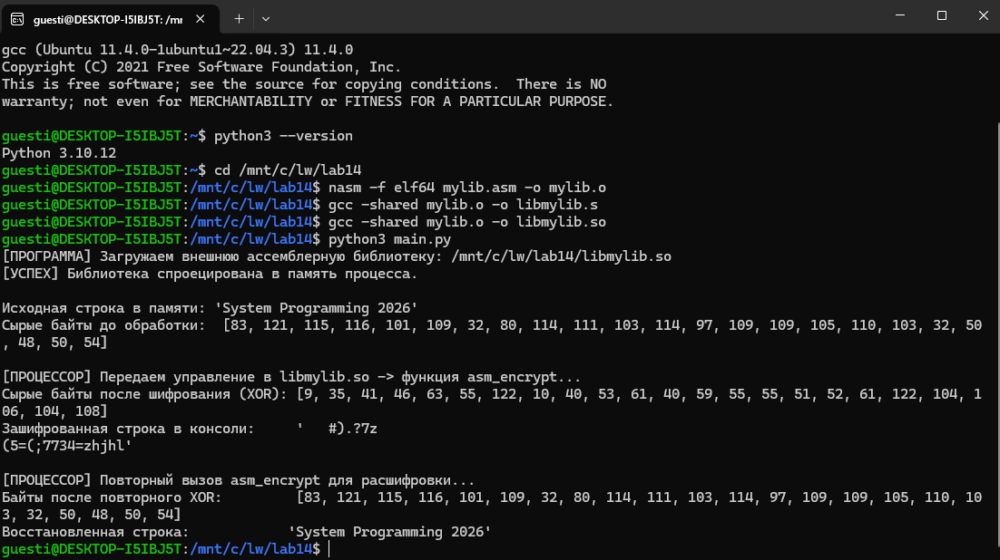
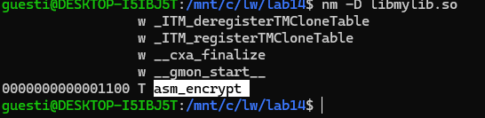

# Лабораторная работа №14
## Создание разделяемой библиотеки Shared Object на языке NASM

**Цель работы:** создать динамическую библиотеку на NASM с позиционно-независимой адресацией и вызвать её функцию из Python.

**Среда:** Linux/WSL x86-64, NASM, GCC, Python 3.

## Исходный код

- [mylib.asm](mylib.asm) — функция asm_encrypt с подробными комментариями.
- [main.py](main.py) — загрузка библиотеки, шифрование и расшифровка строки.

Функция получает адрес буфера через RDI, длину — через RSI. Каждый байт буфера изменяется операцией XOR с ключом 0x5A.

## Сборка и запуск

В терминале Linux/WSL из папки проекта:

```bash
nasm -f elf64 mylib.asm -o mylib.o
gcc -shared mylib.o -o libmylib.so
python3 main.py
```

## Результаты

Библиотека libmylib.so успешно загружена через ctypes.CDLL.

Исходная строка:

```text
System Programming 2026
```

После первого вызова функции байты изменились. Повторный вызов с тем же ключом восстановил исходные байты и строку:

```text
System Programming 2026
```

Это соответствует свойству XOR:

```text
(data XOR key) XOR key = data
```



## Проверка экспорта функции

Выполнена команда:

```bash
nm -D libmylib.so
```

В выводе найдена строка:

```text
0000000000001100 T asm_encrypt
```

Буква T означает, что asm_encrypt — глобальный символ, определённый в секции машинного кода. Значение 0x1100 не является окончательным виртуальным адресом функции после загрузки библиотеки в процесс.



## Ответы на контрольные вопросы

### 1. Как RIP обеспечивает позиционно-независимую адресацию?

RIP содержит адрес исполняемой последовательности инструкций. При RIP-относительной адресации процессор складывает адрес следующей инструкции с записанным в машинном коде смещением.

В инструкции:

```asm
mov al, [rel encryption_key]
```

используется смещение до encryption_key, а не фиксированный абсолютный адрес переменной.

При загрузке библиотеки по другому базовому адресу код и данные перемещаются вместе. Расстояние между инструкцией и ключом сохраняется, поэтому такое обращение продолжает работать.

### 2. Для чего нужны nm и objdump и какие таблицы ELF они используют?

nm выводит символы объектных и исполняемых файлов: их имена, значения адресов и типы. Ключ -D выбирает динамические символы.

objdump позволяет исследовать структуру бинарного файла, его секции, машинные инструкции и таблицы символов. Команда objdump -T выводит динамическую таблицу символов.

В нашей библиотеке эти команды используют динамическую таблицу символов .dynsym и связанную с ней таблицу строк .dynstr, содержащую имена символов. Обычная таблица символов ELF называется .symtab, связанная таблица строк — .strtab.

### 3. Что произойдёт, если убрать вызовы asm_encrypt, но оставить ctypes.CDLL?

Библиотека всё равно будет загружена: ctypes.CDLL вызывает механизм динамической загрузки, который отображает ELF-библиотеку в виртуальное адресное пространство процесса и подготавливает её к использованию.

Но функция asm_encrypt выполняться не будет, поэтому буфер останется неизменным.

Отображение библиотеки не означает, что все её страницы немедленно окажутся в физической оперативной памяти. Linux использует загрузку страниц по требованию: необходимые страницы становятся резидентными при обращении к ним. Некоторые страницы могут уже находиться в файловом кэше или использоваться другими процессами.

Следовательно, отсутствие вызова функции не отменяет загрузку библиотеки в виртуальное адресное пространство, но по одному вызову CDLL нельзя утверждать, что весь её машинный код физически размещён в ОЗУ.
